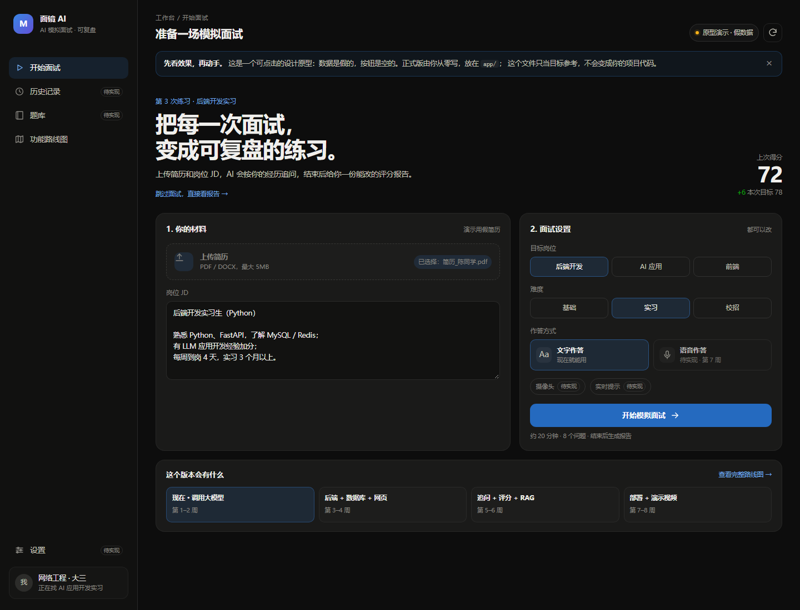

# AI 模拟面试官

一个面向计算机相关专业学生的 AI 面试练习工具：根据简历和岗位 JD 生成针对性问题，进行多轮追问，并在结束后给出结构化评分报告。

> **当前进度**：第 1 周，已完成命令行多轮对话和错误处理；网页版、简历解析和评分报告在开发中。



*上图是目标产品原型（假数据），不是当前命令行版本的截图。*

## 现在能做什么

- 命令行多轮对话，模型能记住上下文
- 输入 `exit` / `quit` / `再见` 退出
- 常见接口错误处理：超时、401、402、429、5xx
- 错误信息区分「用户提示」和「开发者调试详情」（`DEBUG` 开关）

## 技术栈

- Python 3.14
- OpenAI Python SDK（兼容 DeepSeek 的 OpenAI 接口）
- DeepSeek `deepseek-v4-flash`
- python-dotenv
- Git / Gitee / GitHub

## 快速开始

### 1. 克隆仓库

```powershell
git clone https://github.com/cwycwy31/ai-interviewer.git
cd ai-interviewer
```

### 2. 创建虚拟环境并安装依赖

```powershell
python -m venv .venv
.\.venv\Scripts\Activate.ps1
python -m pip install openai python-dotenv
```

### 3. 配置 API Key

在项目根目录新建 `.env`：

```text
DEEPSEEK_API_KEY=你的key
```

`.env` 已被 `.gitignore` 忽略，不会上传。

### 4. 运行

```powershell
python chat.py
```

示例：

```text
你：我叫小明，正在找 AI 应用开发实习
AI：你好小明……
你：我叫什么？
AI：你叫小明……
你：exit
```

## 项目结构

```text
ai-interviewer/
├── chat.py          # 当前：命令行多轮聊天
├── main.py          # FastAPI 后端入口
├── assets/          # README 用的截图
├── README.md
├── .env             # 本地密钥，不提交
└── .gitignore
```

## 开发进度

- [x] 环境搭建与第一次 API 调用
- [x] 命令行多轮对话（保存对话历史）
- [x] 常见接口错误处理
- [x] Git 仓库（Gitee + GitHub）
- [ ] FastAPI 后端 + 网页聊天界面
- [ ] 简历 / JD 解析
- [ ] 多轮追问与结构化评分报告
- [ ] RAG 题库与知识库
- [ ] 部署上线
- [ ] 演示视频与面试话术

## 项目目标

- 练习 AI 应用开发的完整链路：API 调用、对话状态、错误处理、后端、数据库、RAG、部署
- 做成一个可以真实使用、可以展示的完整作品
- 支撑一场 AI 应用开发实习面试

## 说明

README 中的截图是产品原型（假数据），只作为目标参考。正式实现从 `chat.py` 开始，后续会按模块拆分为 `main.py`、`db.py`、`llm.py`。产品原型文件保留在本地 `参考/`，不提交到仓库。

## 仓库

- GitHub：<https://github.com/cwycwy31/ai-interviewer>
- Gitee：<https://gitee.com/cwycwy31/ai-interviewer>

## 作者

网络工程 · 大三，正在找 AI 应用开发实习。
